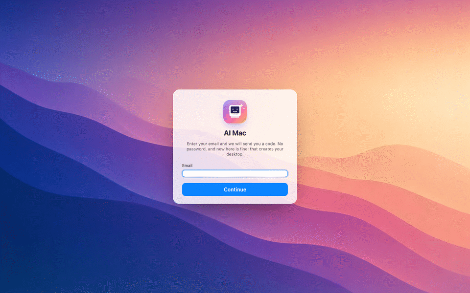
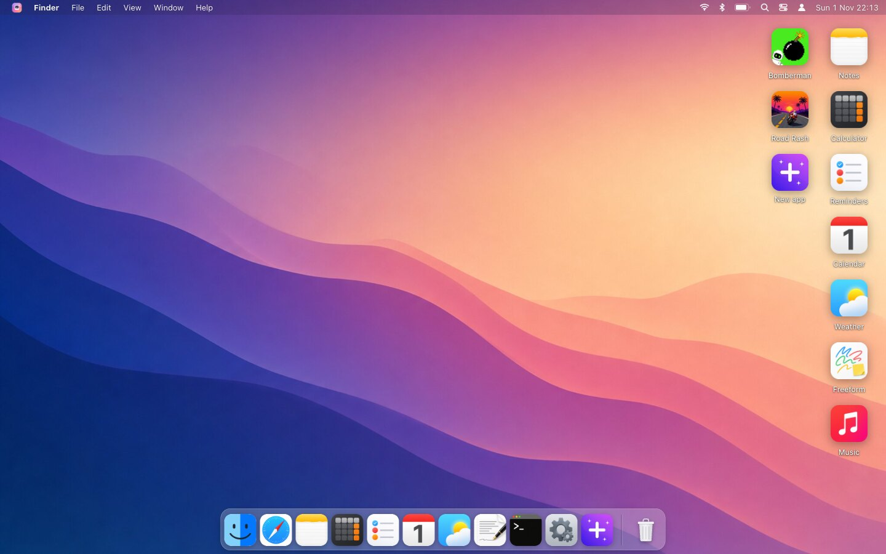
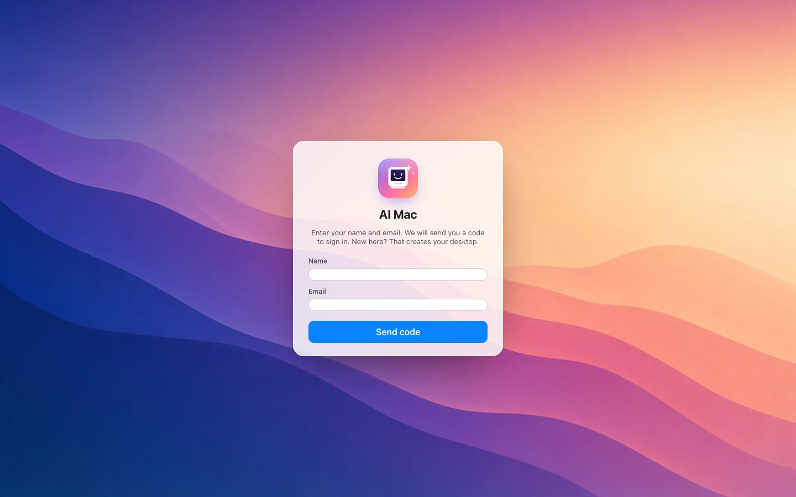
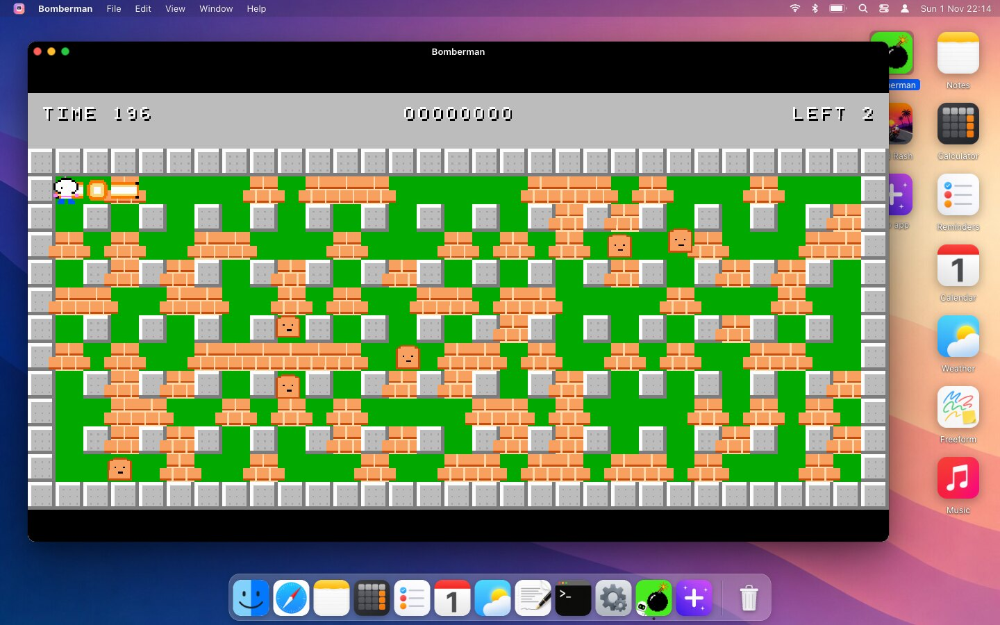
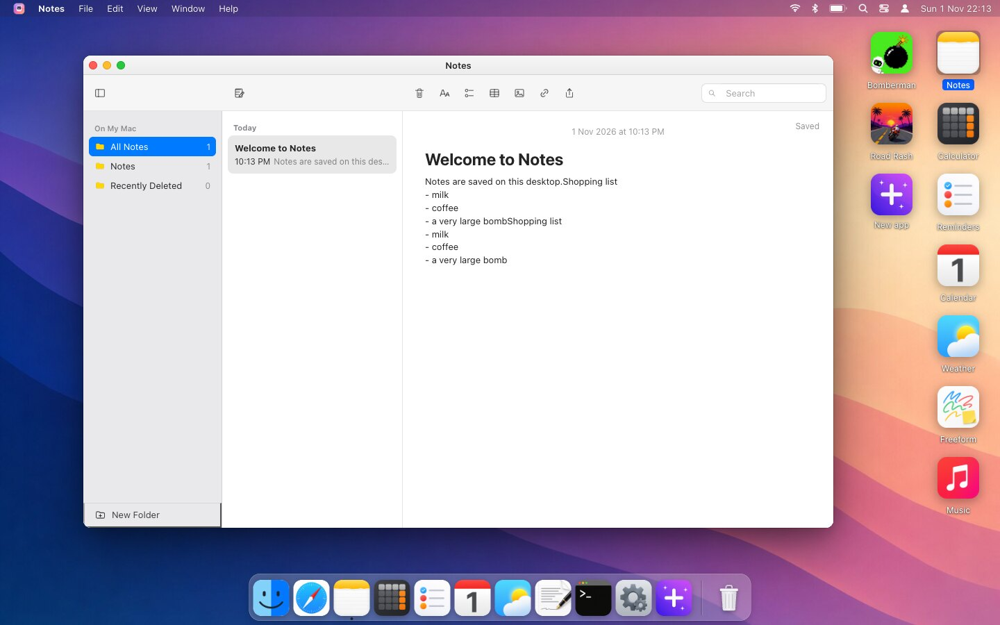
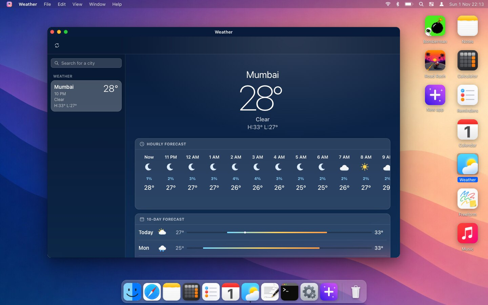
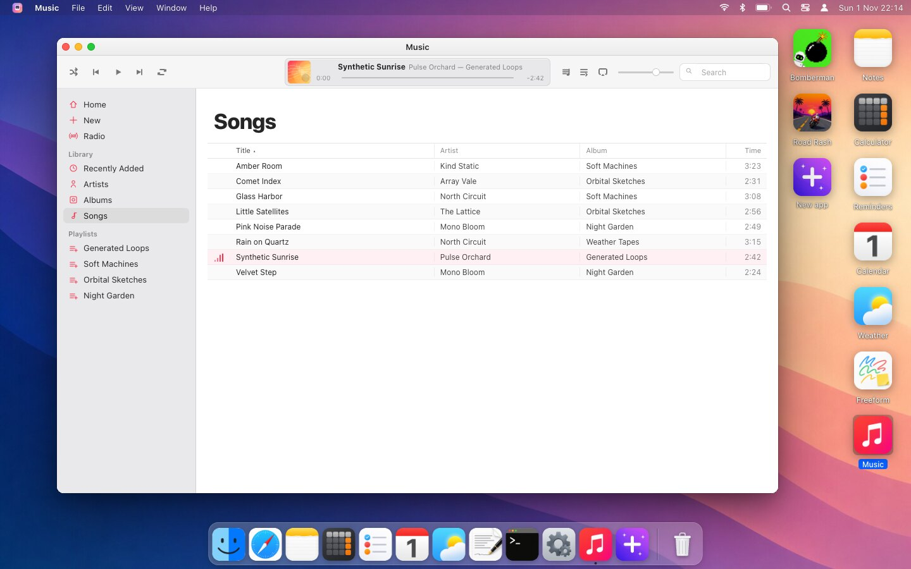
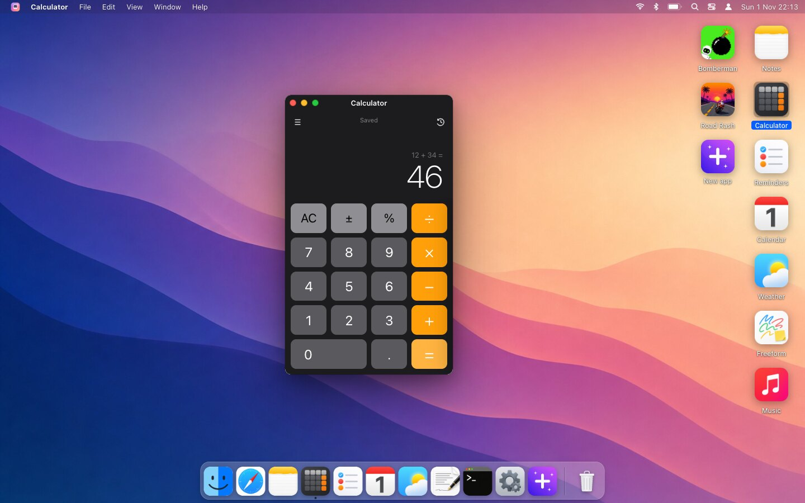
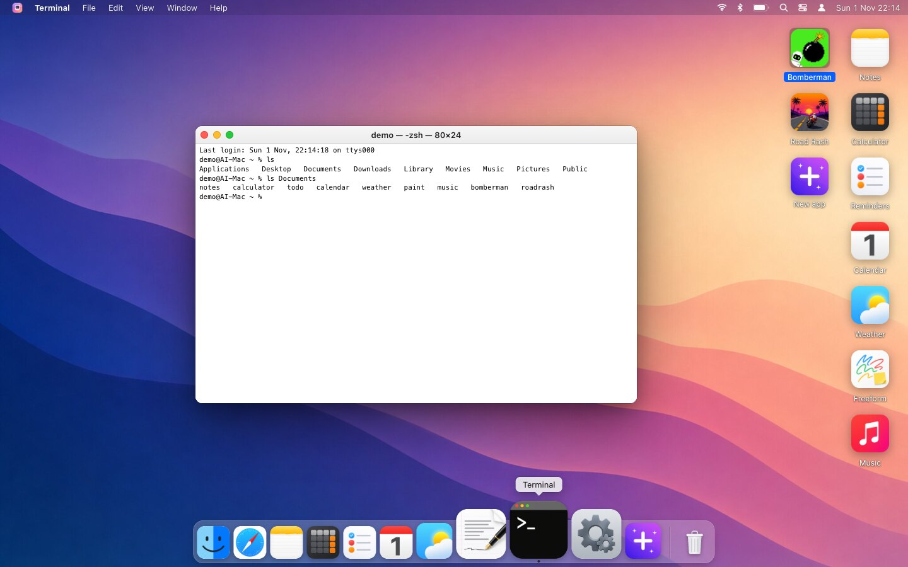
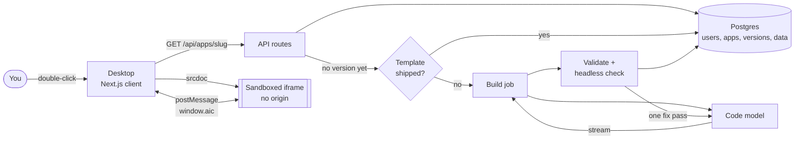

<p align="center">
  
</p>

<h1 align="center">AI Mac</h1>

<p align="center">
  <b>A desktop in your browser whose apps don't exist until you open them.</b><br>
  Double-click an icon, watch a model write the app, and keep it.
</p>

<p align="center">
  <a href="https://ai-mac.jigardafda.com"><b>Live demo</b></a> ·
  <a href="#quick-start">Quick start</a> ·
  <a href="#how-it-works">How it works</a> ·
  <a href="CONTRIBUTING.md">Contributing</a> ·
  <a href="SECURITY.md">Security</a>
</p>

<p align="center">
  <a href="https://github.com/jigardafda/ai-mac/actions/workflows/ci.yml"></a>
  <a href="LICENSE"></a>
  
  
  <a href="CONTRIBUTING.md"></a>
</p>

<p align="center">
  
</p>

> **An experiment, not a product.** AI Mac is an independent project. It is not affiliated with, endorsed by or sponsored by Apple Inc. "Mac", "macOS" and the names of Apple's apps are trademarks of Apple Inc.; the apps here are original code written to resemble them.

## What is it?

Sign in with just your email (a six digit code arrives by email, no password; new here? add your first name) and you get a Mac-style desktop with a dock, a menu bar and a set of icons: Notes, Calculator, Reminders, Calendar, Weather, Freeform, Music and two arcade games. Every user has their own desktop, their own copy of every app and their own data.

- **Open an app that doesn't exist yet and a model writes it in front of you**, streaming the code into the window. It is checked, stored, and from then on loads from your own cache in milliseconds.
- **"New app" turns a sentence into a new icon.** *"A habit tracker with streaks"* becomes an app on your desktop with a generated icon.
- **"Improve" rewrites an app the way you ask**, and keeps every old version so you can roll back.
- **Apps are sandboxed.** Generated code runs in an iframe with no origin and talks to the desktop only through a small, narrow API.
- **It also ships real, hand-written apps:** Finder, TextEdit, Terminal, Safari (a sandboxed proxy browser), System Settings and Activity Monitor, plus reviewed builds of the default apps so a new desktop works at once.

## Screenshots

<table>
  <tr>
    <td width="50%"><br><sub><b>The desktop</b> — menu bar, dock with magnification, icons on the right.</sub></td>
    <td width="50%"><br><sub><b>Sign in</b> — your email, then a code. New here? Add your first name, prefilled from the email.</sub></td>
  </tr>
  <tr>
    <td><br><sub><b>Bomberman</b> — a playable arcade game, written by the model and reviewed.</sub></td>
    <td><br><sub><b>Notes</b> — saved per app on the server.</sub></td>
  </tr>
  <tr>
    <td><br><sub><b>Weather</b> — live data from Open-Meteo, no key needed.</sub></td>
    <td><br><sub><b>Music</b> — a library with generated loops.</sub></td>
  </tr>
  <tr>
    <td><br><sub><b>Calculator</b> — keyboard and mouse.</sub></td>
    <td><br><sub><b>Terminal</b> — a small shell over your own files.</sub></td>
  </tr>
</table>

## Quick start

You need **Node 24+** and **Postgres**. You do **not** need an OpenAI key to try it: the default apps ship as reviewed templates, so the desktop, the built-in apps and every default app work without one. A key is only needed to generate new apps, use "Improve", or let apps call `aic.ask`.

```bash
git clone https://github.com/jigardafda/ai-mac.git
cd ai-mac

docker compose up -d            # Postgres on 127.0.0.1:5495 (dev credentials, local only)
cp .env.example .env.local      # then set SESSION_SECRET (see the comment inside)
npm install
npm run dev                     # http://localhost:3000
```

Sign in with any email. In development the six digit code is **printed in the terminal** instead of being emailed, so you need no mail provider. The schema creates itself on first use.

To generate new apps, add `OPENAI_API_KEY` to `.env.local`.

### Configuration

| Variable | Required | Purpose |
| --- | --- | --- |
| `DATABASE_URL` | yes | Postgres connection string |
| `SESSION_SECRET` | yes | signs the session cookie and keys the sign-in code hashes; use 32+ random bytes (`openssl rand -hex 32`) |
| `RESEND_API_KEY` | production | sends the sign-in emails through [Resend](https://resend.com); without it, production refuses to start a sign-in |
| `MAIL_FROM` | no | sender address, default `AI Mac <noreply@jigardafda.com>`; **set this to your own verified domain** |
| `ADMIN_EMAILS` | no | comma separated addresses allowed into the admin panel at `/admin`; unset turns the panel off |
| `OPENAI_API_KEY` | for generation | code, chat and image models |
| `AIC_CODE_MODEL` | no | default `gpt-5.5` |
| `AIC_CHAT_MODEL` | no | default `gpt-5.4-mini`, used by `aic.ask` |
| `AIC_IMAGE_MODEL` | no | default `gpt-image-2`, used for new app icons |
| `DEV_ORIGINS` | no | comma separated hosts allowed to reach the dev server |

### Scripts

| Command | What it does |
| --- | --- |
| `npm run dev` | start the dev server |
| `npm run build` / `npm start` | production build and server |
| `npm run lint` | ESLint |
| `npm run typecheck` | TypeScript, no emit |

## How it works



## Under the hood

### The pieces

- **Next.js 16** (App Router, TypeScript) serves the desktop and the API. **Postgres** stores users, apps, app versions (the generated code) and app data.
- **Generation**: `lib/generate.ts` asks the code model (`gpt-5.5` by default) for one self-contained HTML document per app: inline CSS and JS, no frameworks, no external scripts. The response streams back to the window so you watch the code being written. `validateApp` rejects anything that reaches for the parent page, cookies or external scripts.
- **Sandbox**: an app runs in `<iframe sandbox="allow-scripts">` via `srcdoc`, so it has no origin and cannot touch the desktop or your session. The host injects a small bridge (`lib/sandbox.ts`) that gives the app `window.aic`:
  - `aic.storage.get / set / keys` — per-app JSON storage on the server
  - `aic.ask(prompt)` — a short answer from a cheaper chat model
  - `aic.open(slug)`, `aic.setTitle(text)`, `aic.notify(text)`
  Everything goes over `postMessage` with request ids; the host answers through the normal authenticated API.
- **Shipped builds**: every default app also has a reviewed build in `templates/<slug>.html`. The first open installs that copy in a few hundred milliseconds, so a new desktop works at once; "Rebuild From Scratch" in the app menu writes a fresh one from the brief instead. Bomberman and Road Rash ship the same way.
- **Caching**: the first open builds version 1 and stores it. Later opens fetch `GET /api/apps/<slug>` and get the stored HTML. "Improve" and "Rebuild" create new versions; `/api/apps/<slug>/versions` lists them and can roll back.
- **Images**: the wallpaper and the default icons were generated once with the image model and live in `public/`. Icons for new apps are generated when the app is created.

## The life of an app

```
double-click icon
      |
      v
GET /api/apps/<slug> ---- version stored? ----yes----> HTML from your cache (milliseconds)
      |                                                       |
      no                                                      v
      |                                              <iframe sandbox="allow-scripts" srcdoc>
      v                                                       ^
template in templates/<slug>.html?  --yes--> installed as v1 --+
      |
      no
      v
build job (lib/jobs.ts) --> model streams the code --> validate --> run in headless Chromium
                                  |                                        |
                                  v                                        v
                      code appears in the window            problems? one automatic fix pass
                                                                           |
                                                                           v
                                                           stored as version N, app opens
```

1. **Open.** The desktop asks the API for the app. If a version is stored, its HTML comes straight back and renders in a sandboxed frame.
2. **Install or build.** With no stored version, a reviewed template is installed if one ships for that slug; otherwise a build job starts. "New app" first asks the model to turn your sentence into a name, slug, brief and icon prompt (`designApp`).
3. **Stream.** The model writes one HTML document and the chunks stream to the window as they arrive, so you watch the app being written.
4. **Validate.** `validateApp` rejects documents that are too small or too large, have no markup, reach for `parent.location`, `top.location`, `window.top` or `document.cookie`, or load an external `<script src>`.
5. **Check.** `lib/check.ts` loads the app in headless Chromium with a stubbed `window.aic`, waits about two seconds, and reports uncaught exceptions, console errors, a blank page and horizontal overflow at 1000px and 560px wide.
6. **Fix.** If the check found problems, the model gets one chance to fix them. The fixed version is kept only if it has fewer problems than the first.
7. **Store.** The result is saved as a new row in `app_versions` and becomes the app's current version.

### Builds are jobs, not requests

A build runs as a server-side job that outlives the HTTP request that started it (`lib/jobs.ts`). Close the window, reload the page or open the same app twice and you attach to the same job, which replays what has been written so far and then follows it live. A build cannot be lost or started twice. Finished jobs stay attachable for 30 seconds for late reloads, and a job that has not finished after 12 minutes is treated as abandoned. Jobs live in process memory, so this assumes one server instance.

### Versions

Every build, "Improve" and "Rebuild From Scratch" writes a new version with the prompt and model that produced it. `GET /api/apps/<slug>/versions` lists them and can roll back, so an improvement that goes wrong costs one click.

## The model's rulebook

The system prompt in `lib/generate.ts` is most of the product. It tells the model to return one complete HTML document with everything inline, no frameworks and no external scripts, and to behave like a real macOS app: system font and 13px body text, the standard control sizes and colours, SF Symbols-style inline SVG icons, subtle hover and press motion, sidebars that collapse under 760px, and no `alert`, `confirm` or `prompt`. It also carries rules learnt from user testing, such as saving once on Enter, showing a quiet "Saved" confirmation, never showing a dead-end control, and writing dates with the month as a word.

## Data model

Postgres holds everything. The schema is created on first use (`ensureSchema` in `lib/db.ts`), and every statement is idempotent, so there are no migrations to run.

| Table | Holds |
| --- | --- |
| `users` | email and display name |
| `login_codes` | pending sign-in codes: HMAC of the code, expiry, attempts, a hash of the requesting browser's challenge |
| `apps` | one row per user per app: slug, name, brief, icon, dock position, current version, soft-delete time |
| `app_versions` | the generated HTML for each version, with the prompt and model that wrote it |
| `app_data` | per-app key and JSON value, the storage behind `aic.storage` |
| `user_settings` | wallpaper, dock contents and preferences |

Everything is keyed by user, so every account has its own desktop, its own copies of the apps and its own data. Sessions are a signed, HttpOnly, `Secure` cookie (`jose`, HS256, 14 days). There are no passwords: `login_codes` holds the pending sign-in codes.

## Security model

Generated code is untrusted code, so the design assumes the model can write something bad.

- **No origin.** Apps run in `<iframe sandbox="allow-scripts">` loaded through `srcdoc`. Without `allow-same-origin` the frame has an opaque origin: it cannot read your cookies, call the API as you, or touch the desktop page.
- **A narrow door.** The only way out is the `window.aic` bridge over `postMessage`. The host answers each request through the normal authenticated API, scoped to the signed-in user and that one app.
- **A validator and a runtime check** catch the obvious escapes and the obvious breakage before an app is stored.
- **The built-in browser is a proxy** (`app/api/browse/route.ts`). It refuses non-http(s) addresses, addresses with credentials, `localhost`, `.local` and `.internal` names, and any host that resolves to a private or link-local address. It caps responses at 4 MB, strips frame-blocking headers, and runs the page in its own sandboxed frame with an opaque origin so page scripts cannot reach your session.
- **Codes are bound to their purpose.** A sign-in code cannot open the admin panel and an admin code cannot sign in to a desktop, even for the same address.
- **Sign-in is an emailed code** (`lib/otp.ts`). The code is six digits from a CSPRNG, stored only as an HMAC, valid for 10 minutes, single use, and locked after 5 wrong tries (counted atomically, so parallel guesses cannot beat the limit). Requests are limited to one per 30 seconds and 5 per hour per address, and 20 per hour per IP; the limits are checked and the code stored under a database lock per address and per IP, so a burst of parallel requests cannot slip past them. Each code is bound to the browser that requested it, so a stranger who knows only your address cannot use up your tries. The sign-in page asks only for an email and then, for a new address, a first name, so the request endpoint does say whether an address already has a desktop; the rate limits above stop that being a free lookup. Names are stripped of control characters and angle brackets and HTML-escaped in the email.
- **Hardened responses.** Every response carries HSTS, `nosniff`, `X-Frame-Options: SAMEORIGIN` and a `frame-ancestors 'self'` policy, a strict referrer policy and a locked-down permissions policy.
- **Secrets stay server-side.** The OpenAI key is only ever read by the server. Apps get a short answer from `aic.ask`, never a key.

This is still an experiment. The validator is a filter, not a proof. Do not point it at anything you cannot afford to lose.

## The built-in apps

Besides the generated apps, the desktop has a set of real, hand-written components in `components/`:

| App | What it is |
| --- | --- |
| Finder | browses your files, a small file system stored in Postgres (`lib/files.ts`), with the usual macOS folders and a Trash |
| TextEdit | edits the text files in that file system |
| Terminal | lists and reads the same files with `ls`, `cat` and friends |
| Safari | the proxy-backed browser, with Reader mode, find and zoom |
| Settings | wallpaper, dock and appearance preferences |
| Activity Monitor | shows running windows and builds |
| Presentation | a short deck about the project |

The menu bar, dock (with magnification and zoom-from-icon), window chrome and traffic lights are in `components/` too.

## How the look is kept honest

The shell follows macOS measurements (24px menu bar, 28px title bar, 12px traffic lights 8px apart, 22px menu rows, dock magnification, zoom-from-icon, minimise-to-dock). Each default app's brief in `lib/catalog.ts` names the real macOS app and describes its layout, and the system prompt in `lib/generate.ts` carries a macOS design system (colours, control sizes, typography, motion).

To check fidelity, screenshots of each app are taken with Playwright and reviewed by a second model (Codex CLI, `codex exec -i screenshot.png`), which lists the most visible differences from the real app. Those findings go back into the briefs, and "Rebuild" writes the app again. The default apps always build from the current brief, so an old desktop picks up improvements when it rebuilds.

## Project layout

```
app/              pages and API routes
  login/          email, then the emailed code (and a first name for new addresses)
  desktop/        the desktop page
  admin/          the read-only admin dashboard (ADMIN_EMAILS only)
  api/auth/       otp/request, otp/verify, logout
  api/apps/       list, create; per app: get or build, improve, data, ask, versions
  api/browse/     the sandboxed proxy behind Safari
  api/files/      the per-user file system behind Finder, TextEdit and Terminal
components/       Desktop (menu bar, icons, dock, windows), AppWindow (iframe, bridge, build UI) and the built-in apps
lib/              db, auth, otp, catalog of default apps, generation, jobs, sandbox bridge, runtime check
templates/        reviewed builds of the default apps, installed on first open
public/           wallpaper, icons and the logo
docs/images/      README screenshots and the tour GIF
```

## Admin panel

`/admin` is a read-only dashboard for whoever runs the instance: totals, every user (name, email, joined, last sign-in, how many apps they have and made), the apps people made with "New app", and for each user the requests that produced their apps.

- **Who can get in** is the `ADMIN_EMAILS` environment variable, never code. Unset, the panel is off.
- **Sign-in is an emailed code**, like the desktop, but only an address on the list is ever sent one. Every valid address gets the same instant reply and cookie, and the real work happens after the response, so nothing in the status, body or timing says who an admin is.
- **It is its own session.** A separate, `SameSite=Strict`, 8 hour cookie that carries no user account, so signing in as an admin does not create a desktop. The list is checked again on every request, so removing an address ends its session.
- **It is read-only and limited on purpose.** It shows counts and what people asked for. It never shows app data, file contents or generated code.
- Admin pages are sent with `Cache-Control: no-store` and `X-Robots-Tag: noindex`.

## Deploying

It runs as one Next.js service plus Postgres, for example on [Railway](https://railway.com): add a Postgres, set `DATABASE_URL`, `SESSION_SECRET`, `RESEND_API_KEY`, `MAIL_FROM` and (optionally) `OPENAI_API_KEY`, deploy from this repository, and the schema creates itself on first request. Use Node 24 or newer (`.node-version` pins 26). Headless Chromium for the runtime check is optional: if Playwright cannot launch a browser, the check is skipped rather than blocking the build.

Verify your sending domain in Resend (DKIM, SPF and ideally DMARC records) before going live, or sign-in emails will not arrive.

## Known limits

- A build takes about a minute and costs a model call; a desktop with many users builds each app once per user.
- Apps are single HTML files under roughly 900 lines, so they stay small by design.
- Generated code is reviewed by a validator, not by a person. Keep this on a trusted network.

## Contributing

Contributions are welcome, from typo fixes to new shipped apps. Please read [CONTRIBUTING.md](CONTRIBUTING.md) first; it covers setup, the checks every change must pass, and how to add a template app. By taking part you agree to the [Code of Conduct](CODE_OF_CONDUCT.md).

Good places to start:

- **Add or improve a shipped app** in `templates/` (it is one HTML file).
- **Make builds survive a restart** by moving the in-memory job store (`lib/jobs.ts`) into Postgres.
- **Teach the validator more** about what generated code must not do (`lib/sandbox.ts`).
- **Tests.** There is no test suite yet; the enemy-movement fix in Bomberman was verified with a headless simulation that would make a good starting point.

## Security

Found a vulnerability? Please **do not open a public issue**. Report it privately as described in [SECURITY.md](SECURITY.md).

## License

[MIT](LICENSE) © 2026 Jigar Dafda. Third-party trademarks belong to their owners.
